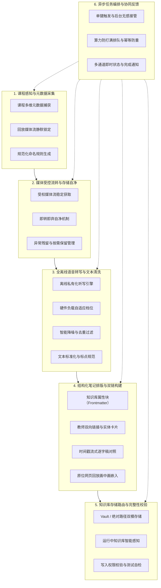

# 课程回放一键剪藏与知识库归档工具 —— 功能需求与业务价值蒸馏

> **说明**：本文档完全摒弃具体技术选型与实现路径（如特定编程语言、运行时环境、底层模型与接口协议等），纯粹从**产品定位、业务价值、功能模块与用户旅程**维度对该系统进行业务抽象与功能蒸馏。

---

## 一、 产品定位与核心价值主张

### 1.1 一句话定位
面向高校在线课程回放平台的**一键式本地化「课堂笔记自动生成与个人知识库归档」助手**。

### 1.2 核心价值主张
将**不可全文检索、体积庞大臃肿、复习跳转困难**的线上流媒体网课视频，一键转化为**带完备元数据、按时间戳精准对齐、具备双链能力、可离线检索复习**的结构化个人知识库笔记。

---

## 二、 业务痛点与解决对策

| 序号 | 传统复习痛点 | 系统的业务解决对策 |
| :---: | :--- | :--- |
| **1** | **视频回看成本过高**<br>1~2 小时的网课视频无法直接全文搜索，找知识点全凭拖动进度条盲猜。 | **全文可搜 + 逐字稿速读**<br>将数小时的课堂语音提炼为标准文本，配合精准时间戳，复习耗时从“小时级”压缩到“分钟级”。 |
| **2** | **手工笔记效率低下**<br>学生一边听课一边暂停打字，极易打断听课思绪，遗漏关键板书与讲解。 | **一键无感全自动成稿**<br>点击一次即可交由后台静默处理，自动完成抓取、听写、排版与归类全流程。 |
| **3** | **硬盘存储空间焦虑**<br>高清课程视频动辄单节数百兆至数吉字节（GB），长期保存极易占满磁盘。 | **即转即删的轻量化存储**<br>仅把音视频作为瞬态流处理介质，转写完成即刻彻底销毁，仅留存几十千字节（KB）的文本笔记。 |
| **4** | **隐私泄露与合规风险**<br>商业云端语音识别或公网大模型存在课程版权扩散、个人学习隐私外泄的隐患。 | **全流程离线闭环**<br>所有媒体拉取、语音转写、文本加工均在用户个人电脑内部封闭运行，零数据出机。 |
| **5** | **信息孤岛与碎片化**<br>零散的视频文件或独立文档无法与既有的个人笔记体系（如 Obsidian）形成网状关联。 | **知识管理规范原生产物**<br>自动生成符合知识库规范的属性块（Frontmatter）、双向链接、内嵌回放窗口与分类标签。 |

---

## 三、 核心功能矩阵（六大能力模块）



### 3.1 模块一：课程感知与元数据采集 (Perception & Metadata)
* **课程多维属性自动识别**：
  * 自动萃取课程名称、学期课次/节次编号（如“第5-6节”）、授课教师、开课日期、教室地点、授课时间段。
  * 自动记录原始回放网页地址，作为知识来源追溯点。
* **媒体流静默定位**：
  * 在播放器加载就绪后，自动侦测并锁定底层音视频流的临时播放地址与有效鉴权标记。
* **标题规范化构建**：
  * 依据业务规则将碎片元数据自动拼装为合规的文件名（例如：`高级语言程序设计实验 2026-03-04第5-6节`），避免非法路径字符破坏文件系统。

### 3.2 模块二：媒体受控流转与存储自净 (Media Lifecycle & Storage)
* **抗网络抖动的稳定流拉取**：
  * 自动化分片请求与故障自愈重试，保证在弱网环境下依然能完整获取课程流。
* **默认“即转即删”自净机制**：
  * 音视频流仅作为转写阶段的瞬态中间产物，笔记成功写入后自动彻底销毁，从根源上消除磁盘爆满隐患。
* **双模存储策略（临时自净 vs 按需持久化）**：
  * 允许用户在设置中开启“保留临时音视频”开关，以便特殊场景下的离线音视频存档。
* **异常垃圾自动回收**：
  * 遇任务中断、网络不可恢复或系统强行退出时，具备异常回收机制，避免僵尸临时文件堆积。

### 3.3 模块三：全离线语音转写与文本清洗 (Speech & Text Processing)
* **100% 离线私有化听写**：
  * 彻底与外部公网大模型或云端语音接口解耦，完全利用本地算力将教师讲授内容转换为文本，确保零数据出境。
* **硬件算力自适应（精度分级）**：
  * 提供自轻量至高精度的多档听写能力档位，匹配不同性能水平的个人电脑（低功耗轻薄本到高性能工作站）。
* **智能降噪与冗余修剪**：
  * 自动探测并跳过长静音停顿、背景杂音及课堂底噪。
  * 过滤重复字词、口吃打巴与低置信度碎片，保证成文紧凑。
* **文本标准化与语言规范**：
  * 自动清洗乱码符号，规范中英文间距与标点符号。
  * 确定性统一为现代规范简体中文。

### 3.4 模块四：结构化笔记排版与双链构建 (Note Structuring & Linking)
* **原生文档元数据（Frontmatter 属性区）**：
  * 笔记头部自动生成标准的属性块，包含标题、原文来源、生成日期、分类标签（如 `#clippings`、`#同济课程` 等）。
* **实体识别与网状双链**：
  * 授课教师自动包裹为知识库双向链接语法（如 `[[张老师]]`），使每节课自动关联到教师知识网络中。
* **时间戳精准映射流**：
  * 按照人类阅读习惯与语意停顿将长文本划分为自然段落。
  * 每段文本头部标注对应的视频播放时间（如 `**12:35** · 讲解内容`），方便查阅时一键对照视频复核。
* **原位网页回放画中画嵌入**：
  * 笔记正文顶部内嵌原始课程回放窗口，复习时无需在浏览器与笔记软件之间繁琐切换，在笔记内部即可直接重温现场画面。

### 3.5 模块五：知识库存储路由与完整性校验 (Vault Storage & Routing)
* **灵活双存储策略**：
  * **知识库（Vault）模式**：直接绑定用户的个人笔记库根目录，指定归档子文件夹（如“课程笔记”），全自动分门别类沉淀。
  * **即时指定绝对目录模式**：支持按需临时指定任意本地绝对路径存储，满足单次个性化存放需求。
* **环境自检与容错**：
  * 能够自动感知系统中正在运行的笔记库，支持交互式文件夹选择。
  * 具备路径合法性校验、磁盘可写权限拦截与“一键生成测试笔记”连通性验证。

### 3.6 模块六：异步任务编排与协同反馈 (Job Orchestration & Feedback)
* **单键触发、无感交互**：
  * 学习者在网课页面点击一下即可离开，无需停留在当前页面苦等耗时的转写过程。
* **单通道算力保护队列**：
  * 引入串行排队机制，防止用户连续快速剪藏多门课程导致电脑算力/内存瞬间被打爆。
  * **幂等性去重**：同一门课程若已在队列或处理中，自动复用当前任务，严防重复下载与转写。
* **全生命周期多通道感知**：
  * 页面角标动态指示（排队中 / 听写中 / 成功 / 失败）。
  * 桌面原生弹窗通知（转写开始提示、最终笔记落盘路径提示）。
  * 异常崩溃自愈（服务意外中断重启后，准确告知历史任务失败状态，引导一键重试）。

---

## 四、 核心业务流程与用户操作旅程

```text
┌────────────────┐      ┌────────────────┐      ┌────────────────┐      ┌────────────────┐
│  1. 课堂学习   │ ───> │  2. 一键剪藏   │ ───> │  3. 异步后台   │ ───> │  4. 笔记消费   │
│                │      │                │      │                │      │                │
│ 浏览器播放网课 │      │ 扩展弹窗点剪藏 │      │ 本地排队+转写  │      │ 打开知识库复习 │
│ 播放器加载完成 │      │ 确认目标归档库 │      │ 自动清理大视频 │      │ 全文检索+查时间│
└────────────────┘      └────────────────┘      └────────────────┘      └────────────────┘
```

1. **触发阶段**：学生在网课回放页面打开弹窗，核对一下保存位置，点击“剪藏”；
2. **后台处理**：系统接管任务，自动拉取流、在本地听写切片、排版成 Markdown、写入指定知识库、清理掉庞大的视频；
3. **完成消费**：弹出桌面通知提示已完成。学生打开知识库即可全文检索这堂课讲过的任意知识点，或者点击时间戳跳转核对板书。

---

## 五、 核心功能特征对比

| 特性维度 | 传统录播学习 | 普通云端转写工具 | 本系统蒸馏出的功能特征 |
| :--- | :--- | :--- | :--- |
| **数据安全性** | 仅在线观看 | 课程音视频上传至第三方商业云端 | **100% 本地离线闭环，零泄露风险** |
| **存储消耗** | 几十 GB 视频堆积 | 需自行下载保存庞大视频源文件 | **瞬态处理即转即删，仅沉淀数十 KB 结构化笔记** |
| **复习检索速度**| 纯人工盲猜进度条 | 散落的非结构化纯文字 | **双向链接 + 时间戳段落 + 原网页回放无缝嵌入** |
| **交互心智负担**| 听课时频繁打断做笔记 | 下载、上传、转写、排版四步人工操作 | **一键单点触发，静默后台排队自愈，通知到人** |

---

## 六、 业务边界与合规约束

1. **用户身份自持**：仅针对已在平台完成身份验证并合法拥有课程回看权限的学习者自身使用。
2. **纯粹纪实，拒绝失真**：坚决不引入大语言模型（LLM）擅自篡改、概括或虚构课堂讲授细节，坚持“所听即所写”的课堂实录还原。
3. **保护源站生态**：严格遵循限速与单任务串行队列机制，杜绝高并发瞬时对校园网络或教学服务器造成冲击。
